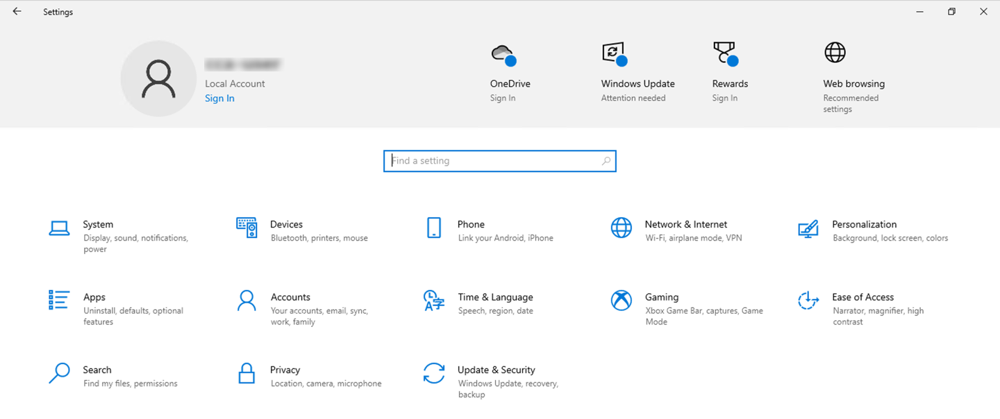
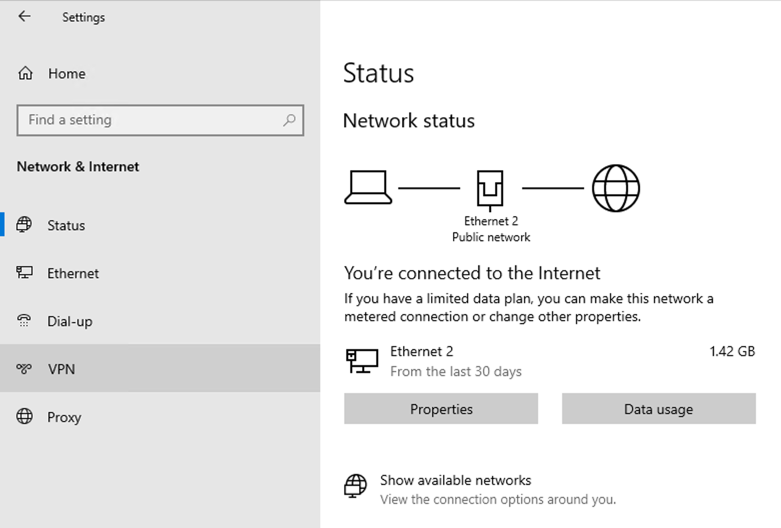
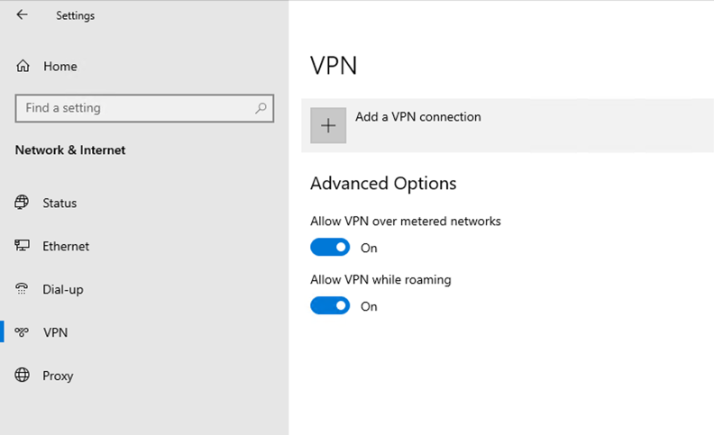
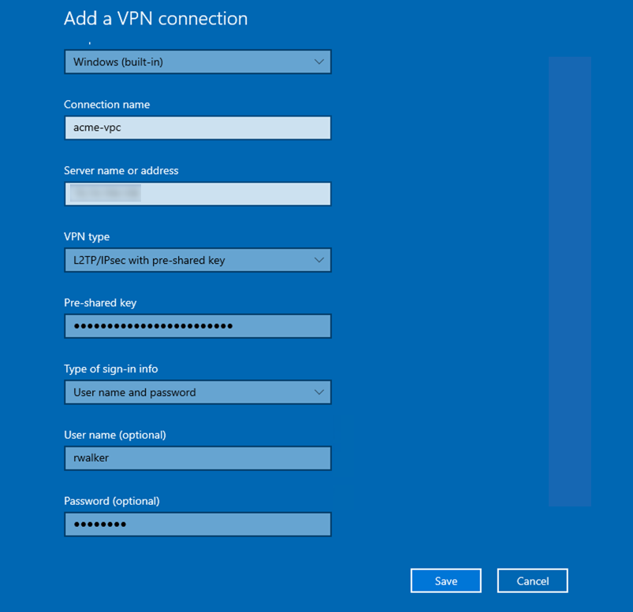
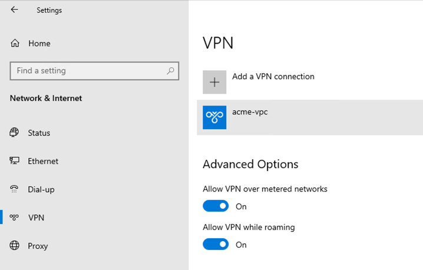
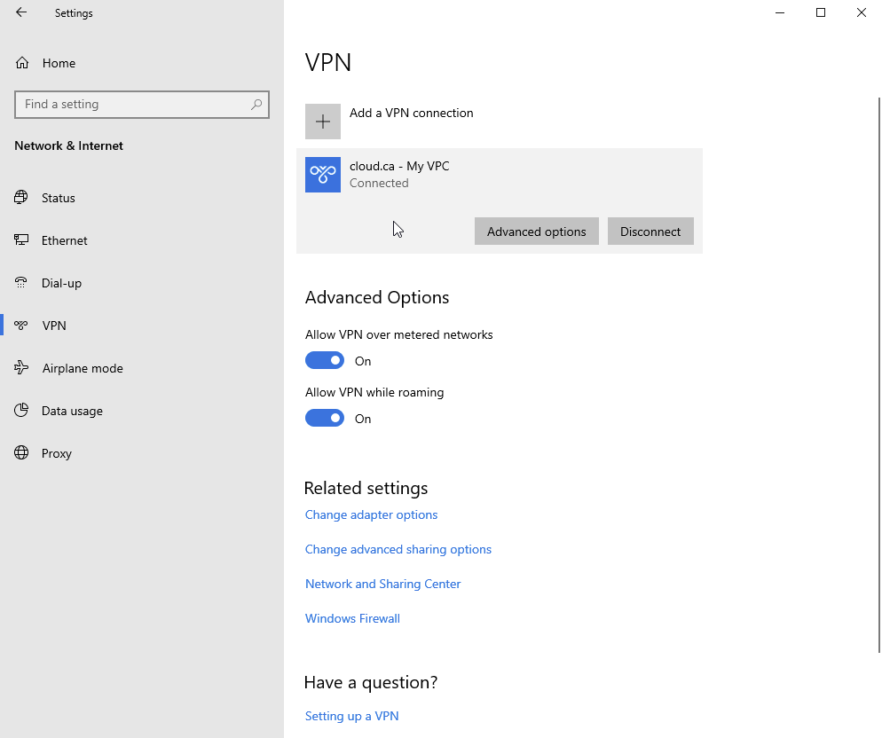

The following instructions apply to Microsoft Windows 10 using its native VPN client:

#### Create network VPN connection
1. Navigate to *Start menu* > *Settings* > *Network & Internet*.

2. Click on *VPN*.

3. Click on *Add a VPN connection*.

4. In the *Add a VPN connection* page:
- **VPN provider:**  *Windows (built-in)*
- **Connection name:**  Enter a name for your VPN connection (e.g., **acme-vpn**)
- **Server name or address:** Enter the public IP address from the *Remote access VPN* page
- **VPN type:** Select *L2TP/IPSec with pre-shared key*
- **Pre-shared key:** Enter the pre-shared key from the *Remote access VPN* page
- **Type of sign-in info:**  Select *User name and password*
- **User name:** Enter the username for the VPN user created for you by your administrator
- **Password:** Enter the password specified for the VPN user

5. Click *Save*.  The *VPN* page will appear and the new connection will appear in the list of connections.

#### Enable split tunneling and configure routing
1. Open a *PowerShell* window.
1. Enable split tunneling: `Set-VpnConnection -Alluserconnection -Name "acme-vpn" -SplitTunneling $true`
   - For the `Name` argument, use the network identifier you identified in step 3, e.g. `acme-vpn`.
1. Add the route: `Add-VpnConnectionRoute -ConnectionName "acme-vpn" -DestinationPrefix "10.0.0.0/16" -PassThru`
   - For the `ConnectionName` argument, use the network identifier you identified in step 3, e.g. `acme-vpn`.
   - For the `DestinationPrefix` argument, use the CIDR of your VPC as displayed in Aptum Portal.
1. Open **Network Connections**, right-click the VPN connection, and navigate to **Properties** > **Networking** > **Internet Protocol Version 4 (TCP/IPv4)** > **Properties** > **Advanced**.
1. Uncheck the option *Use default gateway on remote network*.

#### Initiate VPN connection
1. Navigate to *Start menu* > *Settings* > *Network & Internet* > *VPN*.
2. Click on the desired VPN connection, then click on the *Connect* button.

3. The VPN is now connected.

<!--  -->
