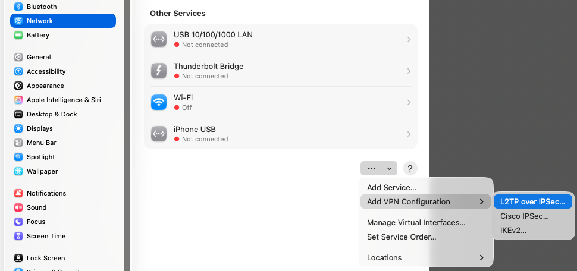
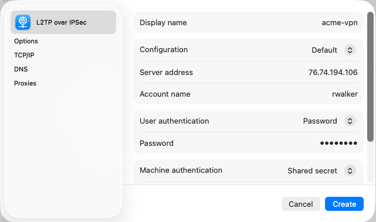

Este sistema operativo incluye un cliente VPN IPSec nativo. A continuación, se detallan los pasos para configurar una conexión VPN:

#### Crear la conexión VPN

1. Abre *Configuración del Sistema* > *Red*.
   
1. Haz clic en el menú emergente **...** y luego en **Agregar configuración de VPN...** > **L2TP sobre IPSec...**:
   - **Nombre mostrado:** Introduce un nombre para tu conexión VPN (p. ej., **acme-vpn**)
   - **Configuración:** Deje la configuración predeterminada
   - **Dirección del servidor:** Introduce la dirección IP pública que aparece en la página *VPN de acceso remoto*
   - **Nombre de la cuenta:** Introduce el nombre de usuario de la VPN que tu administrador te ha asignado
   - **Autenticación del usuario:** Selecciona *Contraseña*
   - **Contraseña:** Introduce la contraseña especificada para el usuario de la VPN
   - **Autenticación del equipo:** Selecciona *Secreto compartido*
   - **Secreto compartida:** Introduce la clave precompartida que aparece en la página *VPN de acceso remoto*
   - **Nombre del grupo:** Deja este campo en blanco
   
1. Haz clic en *Opciones* en la barra lateral.
1. Confirma que el interruptor para *Enviar todo el tráfico a través de la conexión VPN* esté desactivado.
1. Haz clic en *DNS* en la barra lateral.
1. Haz clic en el icono `+` e introduce la dirección IP de uno o más servidores DNS válidos. El servidor DNS de Google `8.8.8.8` debería funcionar.
1. Haz clic en *Crear*.
1. La nueva VPN ya aparece en la página *VPN*. Haz clic en el interruptor para conectarte a la VPN.
   

#### Configurar una ruta para el tráfico de la VPN

1. Abra *Aplicaciones* > *Terminal*.
1. Confirma que la VPN que creaste aparece en la lista de servicios de red: `sudo networksetup -listallnetworkservices`
1. Añade la ruta a la configuración de red: `sudo networksetup -setadditionalroutes "acme-vpn" 10.0.0.0/16 255.255.255.0 ""`
   - Utiliza el identificador de red que determinaste en el paso 3; por ejemplo, `acme-vpn`. 
   - Utiliza el CIDR de tu VPC tal como aparece en Aptum Portal. 
   - Asegúrate de incluir las comillas vacías al final.
1. Confirma que la ruta aparece en la lista de rutas: `sudo networksetup -getadditionalroutes "acme-vpn"`
   - Utiliza el identificador de red que determinaste en el paso 3; por ejemplo, `acme-vpn`.
1. La ruta ya está configurada de forma permanente y se mantendrá tras reiniciar el sistema.

#### Hacer que la VPN esté disponible en la barra de menús

Opcionalmente, se puede habilitar el módulo VPN en la barra de menús para acceder a él más fácilmente:
1. Abra *Configuración del sistema* > *Barra de menús*.
2. Desplácate hasta el control de la barra de menús *VPN*.
3. Haz clic en el interruptor para mostrar el módulo VPN en la barra de menús.
   
3. Ahora puedes conectarte a la VPN desde la barra de menús.
   