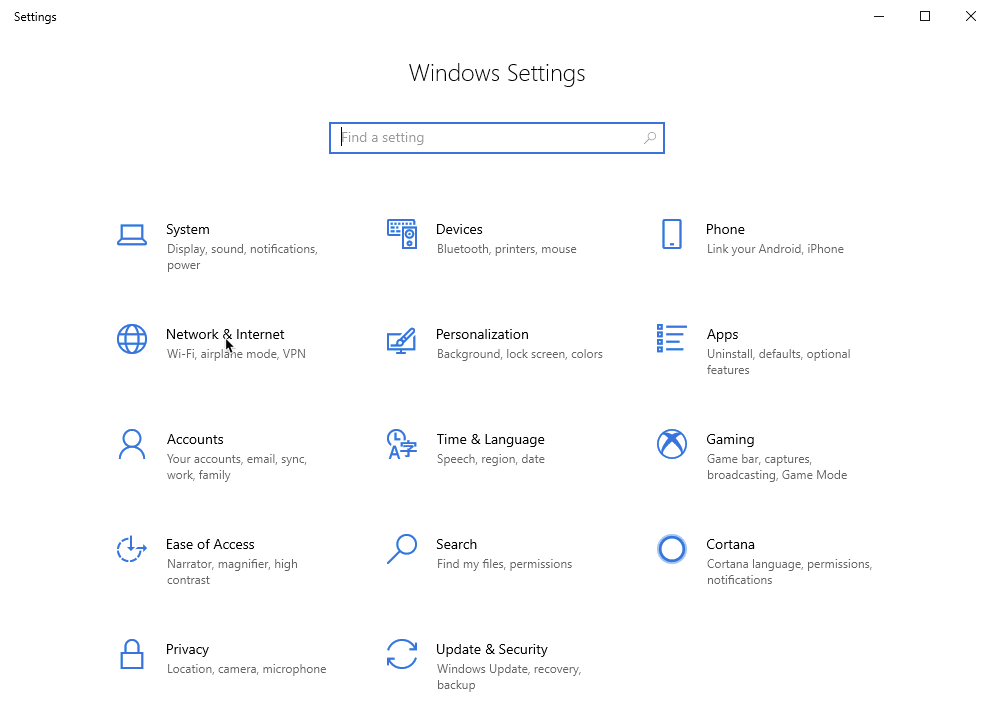
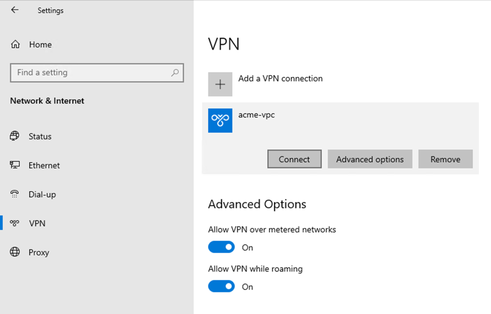

Las siguientes instrucciones se aplican a Microsoft Windows 10 con su cliente VPN nativo:

#### Crear una conexión VPN de red
1. Ve al menú *Inicio* > *Configuración* > *Red e Internet*.

2. Haz clic en *VPN*.

3. Haz clic en *Añadir una conexión VPN*.

4. En la página *Agregar una conexión VPN*:
- **Proveedor de VPN:** *Windows (integrado)*
- **Nombre de la conexión:** Ingrese un nombre para tu conexión VPN (p. ej., **acme-vpn**)
- **Nombre o dirección del servidor:** Ingresa la dirección IP pública de la página *VPN de acceso remoto*
- **Tipo de VPN:** Selecciona *L2TP/IPSec con clave precompartida*
- **Clave precompartida:** Ingresa la clave precompartida de la página *VPN de acceso remoto*
- **Tipo de información de inicio de sesión:** Selecciona *Nombre de usuario y contraseña*
- **Nombre de usuario:** Ingresa el nombre de usuario de la VPN que su administrador creó para ti
- **Contraseña:** Ingresa la contraseña especificada para la VPN

5. Haz clic en *Guardar*. Aparecerá la página *VPN* y la nueva conexión aparecerá en la lista de conexiones.

#### Habilitar el túnel dividido (split tunneling) y configurar el enrutamiento
1. Abre una ventana de *PowerShell*.
1. Habilita el túnel dividido: `Set-VpnConnection -Alluserconnection -Name "acme-vpn" -SplitTunneling $true`
   - Para el argumento `Name`, utiliza el identificador de red que determinaste en el paso 3; por ejemplo, `acme-vpn`.
1. Añade la ruta: `Add-VpnConnectionRoute -ConnectionName "acme-vpn" -DestinationPrefix "10.0.0.0/16" -PassThru`
   - Para el argumento `ConnectionName`, utiliza el identificador de red que determinaste en el paso 3; por ejemplo, `acme-vpn`. 
   - Para el argumento `DestinationPrefix`, utiliza el CIDR de su VPC tal como aparece en Aptum Portal.
1. Abre **Conexiones de red** (*Network Connections*), haz clic con el botón derecho en la conexión VPN y navega a **Propiedades** > **Funciones de red** > **Protocolo de Internet versión 4 (TCP/IPv4)** > **Propiedades** > **Opciones avanzadas**.
1. Desmarca la opción *Usar puerta de enlace predeterminada en la red remota*.

#### Iniciar conexión VPN
1. Ve al menú *Inicio* > *Configuración* > *Red e Internet* > *VPN*.
2. Selecciona la conexión VPN deseada y, a continuación, haz clic en el botón *Conectar*.

3. La VPN ya está conectada.

<!--  -->
