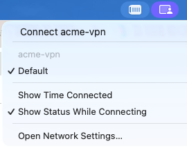

Ce système d'exploitation intègre un client VPN IPSec. Voici la procédure pour configurer une connexion VPN :

#### Créer la connexion VPN

1. Ouvrez *Réglages système* > *Réseau*.
   
1. Cliquez sur le menu contextuel **...**, puis sur **Ajouter une configuration VPN** > **L2TP par IPSec...** :
    - **Nom d'affichage :** Entrez un nom pour votre connexion VPN (par exemple, **acme-vpn**).
    - **Configuration :** Laissez la valeur par défaut.
    - **Adresse du serveur :** Entrez l'adresse IP publique indiquée sur la page *Accès VPN à distance*.
    - **Nom du compte :** Entrez le nom d'utilisateur du compte VPN créé par votre administrateur.
    - **Authentification de l'utilisateur :** Sélectionnez *Mot de passe*.
    - **Mot de passe :** Entrez le mot de passe du compte VPN.
    - **Authentification de la machine :** Sélectionnez *Secret partagée*.
    - **Secret partagée :** Entrez la clé pré-partagée indiquée sur la page *Accès VPN à distance*.
    - **Nom du groupe :** Laissez ce champ vide.
   
1. Cliquez sur *Options* dans la barre latérale.
1. Vérifiez que l'option *Envoyer tout le trafic via la connexion VPN* est désactivée.
1. Cliquez sur *DNS* dans la barre latérale.
1. Cliquez sur l'icône `+` et entrez l'adresse IP d'un ou plusieurs serveurs de noms valides. Le serveur de noms Google `8.8.8.8` devrait convenir.
1. Cliquez sur *Créer*.
1. Le nouveau VPN est maintenant disponible sur la page *VPN*. Cliquez sur le bouton pour vous connecter au VPN.
   

#### Configurer une route pour le trafic VPN

1. Ouvrez *Applications* > *Terminal*.
1. Vérifiez que le VPN que vous avez créé apparaît dans la liste des services réseau : `sudo networksetup -listallnetworkservices`
1. Ajoutez la route à la configuration réseau : `sudo networksetup -setadditionalroutes "acme-vpn" 10.0.0.0/16 255.255.255.0 ""`
   - Utilisez l'identifiant réseau que vous avez déterminé à l'étape 3, par exemple `acme-vpn`.
   - Utilisez le CIDR de votre VPC tel qu'il apparaît dans Aptum Portal.
   - Assurez-vous d'inclure les guillemets vides à la fin.
1. Vérifiez que la route apparaît dans la liste des routes : `sudo networksetup -getadditionalroutes "acme-vpn"`
   - Utilisez l'identifiant réseau que vous avez déterminé à l'étape 3, par exemple `acme-vpn`. `acme-vpn`.
1. La route est maintenant configurée de façon permanente et sera conservée après un redémarrage du système.

#### Rendre le VPN disponible dans la barre de menu

Vous pouvez activer le module VPN dans la barre de menu pour y accéder plus facilement :
1. Ouvrez *Réglages système* > *Barre de menus*.
2. Faites défiler jusqu'à l'option *VPN* dans les commandes de la barre de menus.
3. Cliquez sur le bouton pour afficher le module VPN dans la barre de menus.
   
4. Vous pouvez maintenant vous connecter au VPN à partir de la barre de menus.
   