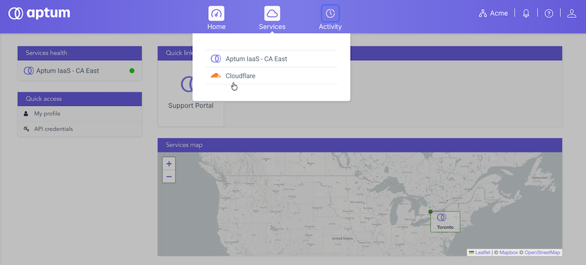

Cet article vous informe d'un changement important concernant vos services DNS. Aptum abandonne sa plateforme DNS existante et transfère tous ses services vers Cloudflare pour une performance et une fiabilité accrues. Cet article explique les changements apportés, les actions à entreprendre et la date limite pour les réaliser.

## Accès à votre nouveau portail

Si vous êtes le gestionnaire technique et que vous n'avez pas reçu vos informations d'identification, veuillez communiquer avec votre personne-ressource principal. Ce dernier a reçu un courriel contenant un accès à Aptum Portal, où vos services DNS sont maintenant hébergés. Ce courriel indique également la date limite de migration.

Si vous ne l'avez pas reçu ou si vous avez besoin d'un accès pour d'autres membres de votre équipe, veuillez nous en informer en communiquant avec votre gestionnaire de compte ou notre équipe de soutien à l'adresse support@aptum.com.

## Ce qu'on a déjà fait

Vos zones DNS et leurs enregistrements ont été importés sur la nouvelle plateforme. Votre service DNS actuel continue de fonctionner sans interruption pendant la migration. Les deux systèmes demeurent donc opérationnels en parallèle et aucune interruption n'est à prévoir. Le courriel envoyé à votre contact principal contient un lien pour configurer l'accès au nouveau Aptum Portal, où se trouve maintenant votre DNS.

**Important :** L'importation automatique copie la plupart des enregistrements, mais pas toujours l'intégralité. Les enregistrements TXT \(SPF, DKIM, DMARC\), certaines configurations de messagerie \(MX\) et des types d'enregistrements moins courants peuvent être omis ou importés différemment. Veuillez considérer la zone importée comme un point de départ à vérifier, et non comme une copie définitive. Les étapes ci-dessous incluent une étape de vérification précisément pour cette raison.

## Ce que vous devez faire

### Avant de commencer

- Vous devez avoir les identifiants de connexion à Aptum Portal
- Vous devez avoir l'URL et les informations de connexion de votre registraire de domaine

### À propos de cette tâche

Vos domaines doivent être commutés pour utiliser les serveurs de noms de Cloudflare.

Suivez ces étapes pour mettre à jour votre registraire de domaine et terminer la migration DNS. Prévoyez environ 15 à 20 minutes de travail actif par domaine, plus jusqu'à 24 heures pour chaque domaine à activer après le changement, plus le temps de propagation DNS normal.

### Procédure

1. Connectez-vous à Aptum Portal en utilisant l'accès que vous avez configuré à partir de votre courriel d'invitation.

2. Dans le menu **Services**, sélectionnez **Cloudflare**.

    

3. Lorsque la page **Environnements** s'affiche, sélectionnez l'environnement dans lequel vos domaines ont été ajoutés.

    **Astuce :** Le nom de l'environnement contenant vos domaines migrés sera au format `imported-[YYYY-MM-DD]`.

4. Pour chaque domaine migré, vérifiez vos enregistrements avant de changer de serveur de noms.

    1. Comparez les enregistrements affichés sur le portail avec votre zone DNS active.

        Portez une attention particulière aux enregistrements MX et TXT \(SPF, DKIM, DMARC\). Si certains sont manquants ou incorrects, ajoutez-les ou corrigez-les dès maintenant sur le portail. Si vous changez de serveur de noms avant d'avoir effectué cette correction, la messagerie et d'autres services pourraient être interrompus.

    2. Vérifiez l'état du proxy.

        Les enregistrements importés en tant que "Proxifiés" \(icône de nuage orange\) acheminent le trafic via Cloudflare et modifient l'adresse IP résolue. Ceci convient généralement aux sites Web, mais peut perturber le fonctionnement des serveurs de messagerie, des serveurs FTP et de tout service nécessitant un accès direct à votre adresse IP réelle. Avant toute modification, configurez les enregistrements qui ne doivent pas être proxifiés en mode "DNS uniquement" \(nuage gris\).

    3.  Vérifiez la présence de DNSSEC.

        Il s'agit de la cause la plus fréquente de l'indisponibilité d'un domaine lors d'une migration. Si DNSSEC est actuellement activé pour votre domaine auprès de votre registraire, vous devez supprimer l'enregistrement DS existant auprès de ce dernier lors de la migration. Si vous modifiez les serveurs de noms alors que l'ancien enregistrement DS est toujours en place, la validation du domaine échouera et la résolution sera impossible, même si tout semble correct.

        Si vous n'êtes pas certain que DNSSEC est activé, contactez-nous et nous vous aiderons à le vérifier.

5.  Pour chaque domaine migré avec le statut **Mise à jour en attente des serveurs de noms**, identifiez son registraire de domaine.

    Si vous ne connaissez pas déjà le registraire d'un domaine, utilisez la fonction **Registraire probable** ou allez à [lookup.icann.org](http://lookup.icann.org/) pour identifier votre registraire de domaine.

6.  Repérez et notez les nouvelles attributions de serveurs de noms pour chaque domaine dans Aptum Portal.

    Ces nouveaux serveurs de noms pointent vers les serveurs de noms de Cloudflare. Vous aurez besoin de ces renseignements pour mettre à jour votre domaine.

7.  Dans un onglet ou une fenêtre de navigateur distinct, connectez-vous au portail de votre registraire de domaine et localisez les enregistrements du serveur de noms pour votre domaine.

8.  Configurez le domaine pour utiliser les serveurs de noms Cloudflare.

    Mettez à jour les enregistrements du serveur de noms pour qu'ils pointent vers les serveurs de noms Cloudflare que vous avez notés à l'étape 6.

9.  Retournez à Aptum Portal, sélectionnez l'icône **…** à côté de l'entrée de domaine pour lancer une analyse du serveur de noms.

    L'analyse peut prendre jusqu'à 24 heures.

10. Une fois que le domaine est en statut **Actif** dans le portail Aptum, vérifiez que votre site Web, votre courriel et tous les autres services associés à ce domaine fonctionnent normalement.

    Si vous constatez un problème, vous pouvez rétablir sans risque la configuration actuelle des serveurs de noms pendant que les deux plateformes sont en cours d'exécution, puis nous contacter et nous vous aiderons à résoudre le problème.

11. Vous devrez répéter les étapes 4 à 10 pour chaque domaine dont le statut est **Mise à jour en attente des serveurs de noms** dans l'environnement `imported-YYYY-MM-DD`.

## Date limite

Veuillez mettre à jour vos serveurs de noms avant la date indiquée dans votre courriel. Notre ancienne plateforme DNS est en voie de mise hors service. Une fois désactivée, tout domaine pointant encore vers les anciens serveurs de noms ne sera plus accessible, ce qui signifie que les sites Web, les messageries et tous les autres services liés à ces domaines cesseront de fonctionner. Nous vous recommandons de ne pas attendre à la dernière minute afin de pouvoir identifier d'éventuels problèmes pendant que les deux systèmes sont encore opérationnels.

## On est là pour vous aider

L'équipe de soutien à la clientèle d'Aptum est là pour vous aider tout au long de ce processus. Si vous n'avez pas reçu votre courriel d'accès au portail, si vous avez besoin d'aide concernant les serveurs de noms ou DNSSEC, ou si vous avez des questions, contactez-nous à l'adresse support@aptum.com. Vous pouvez également consulter notre documentation de migration ici : [https://portal.aptum.com/hc/cloudflare-service](https://portal.aptum.com/hc/cloudflare-service)

Merci de votre fidélité.